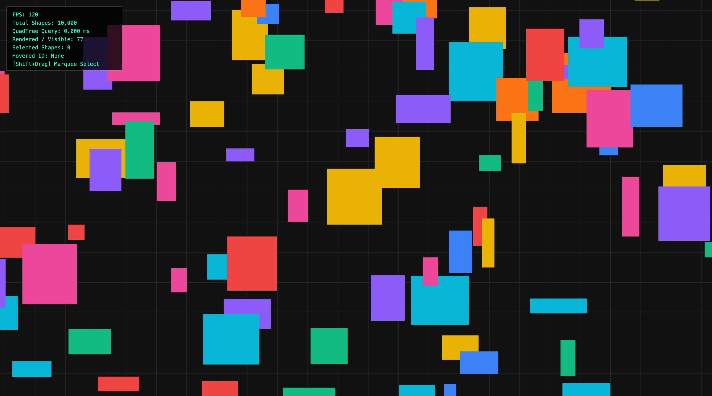
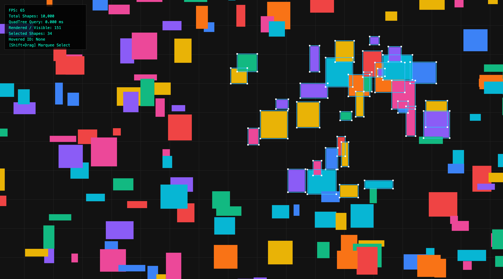

# infinite-canvas-core

A zero-dependency 2D infinite canvas engine built from scratch with TypeScript and HTML5 Canvas, featuring affine viewport transforms, QuadTree spatial indexing, frustum culling, and marquee multi-selection.

---

## Preview

|       Infinite Canvas & Marquee Selection        |     QuadTree Spatial Partitioning (Debug Mode)     |
| :----------------------------------------------: | :------------------------------------------------: |
|  |  |

---

## Features

- **Infinite Coordinate Space**: Smooth panning and pointer-anchored zooming using 2D affine transform matrices.
- **HiDPI / Retina Crispness**: Automatic physical-to-logical pixel synchronization via `devicePixelRatio`.
- **Zero-GC QuadTree Spatial Index**:
  - $O(\log N)$ viewport range queries (Frustum Culling) replacing $O(N)$ linear scans.
  - Instant point hit testing for hovering and selecting among 10,000+ objects.
  - Query ID stamping algorithm for zero-allocation deduplication across tree boundaries.
  - Real-time spatial re-balancing on item movement (`remove` $\to$ `update` $\to$ `insert`).
- **Frame-Budget Scheduler**: Decouples high-frequency pointer and wheel events from the rendering loop via `requestAnimationFrame` dirty flagging to sustain 120 FPS.
- **Adaptive Grid LOD**: Dynamically scales world grid subdivisions to keep screen-space line intervals within readable pixel bounds.
- **Selection & Batch Transformations**:
  - Single-item selection and dragging with visual bounding handles.
  - Marquee rubber-band selection (`Shift` + Drag) powered by QuadTree intersection queries.
  - Batch translation of multiple selected shapes.
- **Visual Spatial Debugger**: Real-time rendering of QuadTree quadrant boundaries, partition depths, and occupancy counters.

---

## Math & Architecture

### 1. Viewport & Coordinate Space Mapping

The camera state consists of translation offsets $(x, y)$ and a zoom factor $s$.

- **Screen to World**:
  $$x_w = \frac{x_s - x}{s}, \quad y_w = \frac{y_s - y}{s}$$

- **Zoom Towards Cursor**:
  To ensure the world coordinate directly under the pointer $(x_s, y_s)$ remains stationary across scaling:
  $$x_{new} = x_s - (x_s - x) \cdot \frac{s_{new}}{s}$$
  $$y_{new} = y_s - (y_s - y) \cdot \frac{s_{new}}{s}$$

### 2. QuadTree Spatial Partitioning

Instead of checking every primitive against the viewport or mouse cursor, space is recursively divided into four quadrants (NW, NE, SW, SE).

- **Branch Pruning**: Any node whose Axis-Aligned Bounding Box (AABB) does not intersect the viewport is skipped entirely.
- **Zero-Allocation Deduplication**: Boundary-crossing elements indexed in multiple leaf nodes are tagged with a monotonically increasing `_lastQueryId`. This prevents redundant array pushes without creating transient `Set` instances in the render loop.

---

## Controls

| Action                            | Input                                              |
| :-------------------------------- | :------------------------------------------------- |
| **Pan Canvas**                    | Left Click / Middle Click Drag on blank area       |
| **Zoom in / out**                 | Mouse Wheel / Trackpad Pinch (anchored to cursor)  |
| **Select & Drag Shape**           | Left Click on any rectangle                        |
| **Marquee Multi-Select**          | `Shift` + Left Click Drag                          |
| **Batch Move**                    | Drag any selected shape when multiple are selected |
| **Toggle QuadTree Debug Overlay** | Press `D`                                          |

---

## Getting Started

### Prerequisites

- [Node.js](https://nodejs.org/) (>= 18)
- [pnpm](https://pnpm.io/)

### Installation & Run

```bash
# Clone the repository
git clone [https://github.com/](https://github.com/)<your-username>/infinite-canvas-core.git
cd infinite-canvas-core

# Install dependencies
pnpm install

# Start local development server
pnpm dev

# Type check & build for production
pnpm build
```

## Project Structure

```
├── index.html         # Fullscreen canvas host & layout
├── src/
│   ├── main.ts        # Input loop, camera pipeline, HUD, and batch interactions
│   └── quadtree.ts    # Recursive QuadTree spatial index and AABB geometry math
├── package.json
└── tsconfig.json      # Strict TypeScript config
```

## License

MIT
